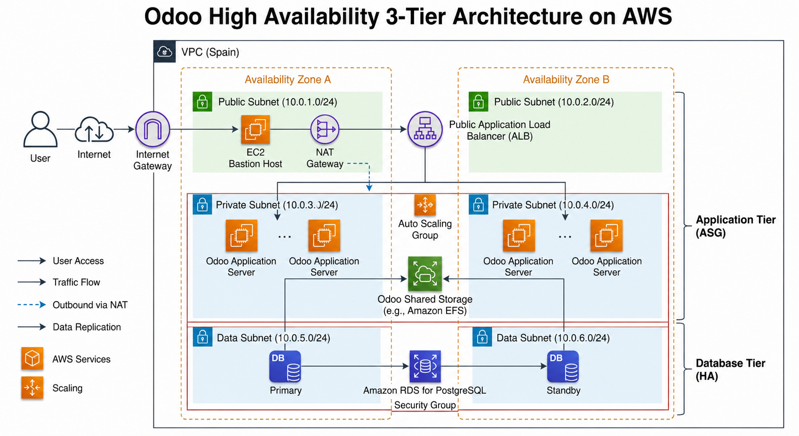

# Beneficios de esta arquitectura

El patrón de arquitectura de 3 capas con Alta Disponibilidad separa **lógicamente** y **físicamente** los componentes del sistema para maximizar la **resiliencia**, la **seguridad** y la **escalabilidad** de Odoo en AWS.

## Arquitectura de 3 Capas (3-Tier)

Divide la infraestructura en tres niveles aislados que pueden escalar de forma independiente:

- **Presentation Tier (User Interface)**: Gestiona el tráfico entrante de los usuarios y actúa como único punto de acceso desde internet.

- **Application Tier (Business Logic)**: Ejecuta la lógica de negocio de Odoo en redes privadas, bloqueando cualquier acceso directo desde el exterior.

- **Data Tier (Data Storage)**: Almacena la base de datos y los archivos compartidos en una subred de máxima seguridad, accesible únicamente por la capa de aplicación.

## Alta Disponibilidad (High Availability - HA)

Garantiza que la aplicación siga operativa incluso si fallan componentes individuales o un centro de datos completo. 
Se logra distribuyendo los recursos de cada capa a través de múltiples **Zonas de Disponibilidad (AZs)** físicas dentro de una misma región de AWS.

# Guía paso a paso

## VPC (Virtual Private Cloud)

```bash
# VPC settings
Resources to create: VPC and more
Name tag auto-generation: odoo
IPv4 CIDR block: 10.0.0.0/16
IPv6 CIDR block: No IPv6 CIDR block
Tenancy: Default

Number of Availability Zones (AZs): 2
  - use1-az4 (us-east-1a)
  - use1-az6 (us-east-1b)

Number of public subnets: 2

Number of private subnets: 4
  # Public subnet CIDR block in us-east-1a 
  - 10.0.1.0/24
  # Public subnet CIDR block in us-east-1b
  - 10.0.2.0/24
  # Private subnet CIDR block in us-east-1a
  - 10.0.3.0/24
  # Private subnet CIDR block in us-east-1b
  - 10.0.4.0/24
  # Private subnet CIDR block in us-east-1a
  - 10.0.5.0/24
  # Private subnet CIDR block in us-east-1b  
  - 10.0.6.0/24

NAT gateways: Zonal
NAT gateways: In 1 AZ
VPC endpoints: None

DNS Options
☑ Enable DNS hostnames
☑ Enable DNS resolution
```

## SG (Security Group)

### SG for EC2

```bash
# Basic details
Security group name: SGec2
Description: SGec2
VPC: odoo-vpc

# Inbound rules:
# Type | Protocol | Port range | Source type   | Source
  SSH  | TCP      | 22         | Anywhere-IPv4 | 0.0.0.0/0
  HTTP | TCP      | 80         | Anywhere-IPv4 | 0.0.0.0/0

# Outbound rules:
# Type       | Protocol | Port range | Destination type | Destination
  All trafic | All      | All        | Custom           | 0.0.0.0/0
```

### SG for ALB

```bash
# Basic details
Security group name: SGalb
Description: SGalb
VPC: odoo-vpc

# Inbound rules:
# Type | Protocol | Port range | Source type   | Source
  HTTP | TCP      | 80         | Anywhere-IPv4 | 0.0.0.0/0

# Outbound rules:
# Type       | Protocol | Port range | Destination type | Destination
  All trafic | All      | All        | Custom           | 0.0.0.0/0
```

### SG for PostgreSQL

```bash
# Basic details
Security group name: SGpostgres
Description: SGpostgres
VPC: odoo-vpc

# Inbound rules:
# Type       | Protocol | Port range | Source type   | Source
  PostgreSQL | TCP      | 5432       | Custom        | SGec2

# Outbound rules:
# Type       | Protocol | Port range | Destination type | Destination
  All trafic | All      | All        | Custom           | 0.0.0.0/0
```

### SG for EFS

```bash
# Basic details
Security group name: SGefs
Description: SGefs
VPC: odoo-vpc

# Inbound rules:
# Type | Protocol | Port range | Source type   | Source
  NFS  | TCP      | 2049       | Custom        | SGec2

# Outbound rules:
# Type       | Protocol | Port range | Destination type | Destination
  All trafic | All      | All        | Custom           | 0.0.0.0/0
```

## Aurora and RDS

### Subnets Group

```bash
# Subnet group details
Name: SGodoo
Description: SGodoo
VPC: odoo-vpc

# Add subnets
Availability Zones (AZs)
  - us-east-1a
  - us-east-1b
Subnets:
  - 10.0.5.0/24
  - 10.0.6.0/24
```

### Database

```bash
# Engine options
Engine type: PostgreSQL

# Choose a database creation method
Full configuration

# Templates
Dev/Test

# Availability and durability
Deployment options: Multi-AZ DB instance deployment (2 instances) 

# Settings
DB instance identifier: odoo-az

# Credentials Settings
Master username: odoo
Credentials management: Self managed
Master password: A123456b
Confirm master password: A123456b
Database authentication options: Password authentication

# Instance configuration
DB instance class: Burstable classes
Instance type: db.t3.micro

# Storage
Storage type: General Purpose SSD (gp2)
Allocated storage: 20 GiB

  # Additional storage configuration
Storage autoscaling: Seleccionamos Enable storage autoscaling
Maximum storage threshold: 1000 GiB

# Connectivity
Compute resource: Don’t connect to an EC2 compute resource
Virtual private cloud (VPC): odoo-vpc
DB subnet group: sgodoo
Public access: No
VPC security group: Choose existing
Existing VPC security groups: SGpostgres
RDS Proxy: Deseleccionamos Create an RDS Proxy
Certificate authority: Dejamos el Default.
  
  # Additional configuration
Database port: 5432 (por defecto al ser PostgreSQL)

# Tags
No tags

# Monitoring
Seleccionamos Database Insights - Standard

Deseleccionamos 'Collect detailed database and per-query metrics'

  # Additional monitoring settings
Deseleccionamos 'Enable Enhanced monitorings'

Dejamos el resto por defecto, vacío.

# Additional configuration
Initial database name: odoo
DB parameter group: default.postgres-18

Deseleccionamos Enable encryption
Deseleccionamos Enable automated backup
Deseleccionamos Copy tags to automated backup
Deseleccionamos Enable auto minor version upgrade

Maintenance window: No preference

Deseleccionamos Enable deletion protection
```

## EFS

### Step 1: File system settings

```bash
# General
Name: odoo
File system type: Regional
Automatic backups: ☑ Enable automatic backups

# Lifecycle management
Transition into Infrequent Access (IA): 30 day(s) since last access
Transition into Archive: 90 day(s) since last access
Transition into Standard: None

Encryption: ☑ Enable encryption of data at rest

# Performance settings
Throughput mode: Enhanced
☑ Elastic

# Additional settings
Performance mode: General Purpose
```

### Step 2: Network access

```bash
# Network
Virtual Private Cloud (VPC): odoo-vpc

# Mount targets
- Cambiamos los Security groups a SGefs, lo demás por defecto.
```

### Step 3: File system policy

```bash
Lo dejamos por defecto.
```

### Step 4: Review and create

```bash
Resumen de la configuración en cada paso.
```

## System Manager

### Parameter Store

#### Parámetro 1

```bash
# Parameter details
Name: /odoo/prod/db_user
Description: Usuario de PostgreSQL para Odoo
Tier: Standard
Data type: String
Value: odoo
```

#### Parámetro 2

```bash
# Parameter details
Name: /odoo/prod/db_password
Description: Password de PostgreSQL para Odoo
Tier: Standard
Data Type: String
Value: A123456b
```

#### Parámetro 3

```bash
# Parameter details
Name: /odoo/prod/admin_passwd
Description: Master password de Odoo
Tier: Standard
Data Type: String
Value: A123456b
```

## EC2 Bastion Host

```bash
# Launch an instance

# Name and tags
Name: odoo-bh

# Application and OS Images (Amazon Machine Image)
Amazon Linux

# Instance type
Instance type: t3.large

# Key pair (login)
Key pair name: vockey

# Network settings:
VPC: odoo-vpc
Subnet: 10.0.1.0/24
Auto-assign public IP: Enable
Firewall: Select existing security group
Common security groups: SGec2

# Configure storage
Configure storage: 22 GiB

File systems: None

# Advanced details:
IAM instance profile: LabInstanceProfile 
(Esto permite que el user-data.txt pueda leer datos del paramater store)

Del resto no tocamos nada.

Añadidmos el siguiente código en User data: 
```

```bash
#!/bin/bash
set -euo pipefail

AWS_REGION="us-east-1"

EFS_DNS="AÑADE AQUÍ EL DNS name del EFS"
EFS_MOUNT="/mnt/odoo-data"
APP_DIR="/home/ec2-user/odoo-pilot"

DB_HOST="AÑADE AQUÍ EL ENDPOINT DE LA BD"
DB_PORT="5432"
DB_NAME="odoo"

SSM_DB_USER="/odoo/prod/db_user"
SSM_DB_PASSWORD="/odoo/prod/db_password"
SSM_ADMIN_PASSWD="/odoo/prod/admin_passwd"

ODOO_IMAGE="odoo:19.0"

# 1. Sistema base
dnf update -y
dnf install -y docker amazon-efs-utils
systemctl enable --now docker
usermod -aG docker ec2-user

# 2. Docker Compose V2
mkdir -p /usr/local/lib/docker/cli-plugins/
if [ ! -x /usr/local/lib/docker/cli-plugins/docker-compose ]; then
  curl -SL https://github.com/docker/compose/releases/latest/download/docker-compose-linux-x86_64 \
    -o /usr/local/lib/docker/cli-plugins/docker-compose
  chmod +x /usr/local/lib/docker/cli-plugins/docker-compose
fi

# 3. Montaje EFS
mkdir -p "${EFS_MOUNT}"

if ! mountpoint -q "${EFS_MOUNT}"; then
  mount -t nfs4 -o nfsvers=4.1,rsize=1048576,wsize=1048576,hard,timeo=600,retrans=2,noresvport \
    "${EFS_DNS}:/" "${EFS_MOUNT}"
fi

grep -q "^${EFS_DNS}:/ ${EFS_MOUNT} " /etc/fstab || \
echo "${EFS_DNS}:/ ${EFS_MOUNT} nfs4 nfsvers=4.1,rsize=1048576,wsize=1048576,hard,timeo=600,retrans=2,noresvport,_netdev 0 0" >> /etc/fstab

# 4. Permisos para Odoo
chown -R 101:101 "${EFS_MOUNT}"
chmod -R 775 "${EFS_MOUNT}"

# 5. Leer secretos desde Parameter Store
DB_USER="$(aws ssm get-parameter \
  --region "${AWS_REGION}" \
  --name "${SSM_DB_USER}" \
  --with-decryption \
  --query 'Parameter.Value' \
  --output text)"

DB_PASSWORD="$(aws ssm get-parameter \
  --region "${AWS_REGION}" \
  --name "${SSM_DB_PASSWORD}" \
  --with-decryption \
  --query 'Parameter.Value' \
  --output text)"

ADMIN_PASSWD="$(aws ssm get-parameter \
  --region "${AWS_REGION}" \
  --name "${SSM_ADMIN_PASSWD}" \
  --with-decryption \
  --query 'Parameter.Value' \
  --output text)"

# 6. Directorio de trabajo
mkdir -p "${APP_DIR}"
cd "${APP_DIR}"

# 7. Configuración de Odoo
cat > odoo.conf <<EOF
[options]
admin_passwd = ${ADMIN_PASSWD}
db_host = ${DB_HOST}
db_user = ${DB_USER}
db_password = ${DB_PASSWORD}
db_port = ${DB_PORT}
db_name = ${DB_NAME}
http_port = 8069
http_interface = 0.0.0.0
proxy_mode = True
list_db = False
data_dir = /var/lib/odoo
EOF

chmod 644 odoo.conf

# 8. Docker Compose
cat > docker-compose.yml <<EOF
services:
  odoo:
    image: ${ODOO_IMAGE}
    container_name: odoo_piloto
    ports:
      - "80:8069"
    volumes:
      - ${EFS_MOUNT}:/var/lib/odoo
      - ./odoo.conf:/etc/odoo/odoo.conf:ro
    restart: always
EOF

# 9. Arrancar Odoo
docker compose pull
docker compose up -d

# 10. Permisos finales
chown -R ec2-user:ec2-user "${APP_DIR}"
```

## Popularizamos la DB

Nos conectamos al Bastion Host y ejecutamos este comando una vez se haya bajado la imágen de Docker y se haya lanzado el contenedor.

```bash
docker exec -i odoo_piloto odoo -c /etc/odoo/odoo.conf -d odoo -i base --without-demo=all --stop-after-init
```

Este comando busca la base de datos en RDS y rellena las tablas y elementos con una instalación de Odoo predeterminada, ya que la base de datos estaba vacía (hasta ahora).

## Crear AMI del Bastion Host

Click derecho en la instancia, click en ```Image and Templates``` y en ```Create Imagen```

```bash
Name: odoo-az
```

## Launch templates

```bash
# Launch template name and description
Launch template name: odoo-az
Template version description: odoo-az
Auto Scaling guidance: Not selected

# Application and OS Images (Amazon Machine Image) 
My AMIs: Owned by me 
AMI: odoo-az (La AMI de la BH que hemos creado previamente)

# Instance type
Instance type: t3.large

# Key pair
Key pair name: vockey

# Network settings:
No definimos Subnet y Availability Zone ya que lo haremos luego al crear el ASG.

Firewall (security groups): Select existing security group
Security groups: SGec2

# Storage (volumes) 
Ya definido gracias a la AMI.

# Advanced details:
IAM instance profile: LabInstanceProfile

El resto por defecto.
```

## ASG (Auto Scaling Group)

### Step 1: Choose launch template or configuration

```bash
# Name
Auto Scaling group name: odoo

# Launch template
Launch template: odoo-az
```

### Step 2: Choose instance launch options

```bash
# Network 
VPC: odoo-vpc
Availability Zones and subnets: 
  - 10.0.3.0/24
  - 10.0.4.0/24
Availability Zone distribution: Balanced best effort

# Additional capacity settings
Capacity Reservation preference: Default
```

La opción de ```Balanced best effort``` significa que si al lanzarlo falla en una zona de disponibilidad, Auto Scaling intentará lanzarlo en otra zona de disponibilidad que se encuentre en buen estado.

### Step 3: Integrate with other services

```bash
# Load balancing
Select Load balancing options: Attach to a new load balancer

  # Attach to a new load balancer
Load balancer type: Application Load Balancer
Load balancer name: odoo-alb
Load balancer scheme: Internet-facing
VPC: odoo-vpc
Availability Zones and subnets: (Seleccionamos las dos subredes públicas)
  - Subred Pública 1
  - Subred Pública 2
Listeners and routing:
  Protocol: HTTP
  Port: 80
  Default routing (forward to): Create a target group 
  New target group name: odoo-alb

# VPC Lattice integration options
Select VPC Lattice service to attach: No VPC Lattice service

# Application Recovery Controller (ARC) zonal shift
Enable zonal shift: Deseleccionada

# Health checks
No seleccionamos nada y lo dejamos por defecto, ya que lo tocaremos después cuando nos lo cree.
```

### Step 4: Configure group size and scaling

```bash
# Group size
Desired capacity: 2

# Scaling
# Scaling limits
Min desired capacity: 2
Max desired capacity: 4

# Automatic scaling
Choose whether to use a target tracking policy: No scaling policies

# Instance maintenance policy
Choose a replacement behavior depending on your availability requirements: No policy

# Additional settings
Instance scale-in protection: Deseleccionamos Enable instance scale-in protection
Monitoring: Deseleccionamos Enable group metrics collection within CloudWatch
Default instance warmup: Deseleccionamos Enable default instance warmup
seconds
Auto Scaling group deletion protection: None
Placement group: None
```

### Step 5: Notifications

```bash
No añadimos notificaciones.
```

### Step 6: Add tags

```bash
No añadimos tags.
```

### Step 7: Review

```bash
Resumen de la configuración en cada paso.
```

## Modificamos Health Check del TG

```bash
# Health checks
Health check protocol: HTTP
Health check path: /web/login

# Advanced health check settings
Health check port: Override (80)
Healthy threshold: 5
Unhealthy threshold: 5
Timeout: 5 seconds
Interval: 30 seconds
Success codes: 200-399
```

---

[!CAUTION]
Es posible que a lo que se nos creen las instancias del ASG, si vamos a Targets dentro de Target Group, no nos aparezcan registradas las dos máquinas que acaban de crearse. Para ello, debemos registrarlas manualmente.

---

[!IMPORTANT]
Copiando el DNS name del Load Balancer que hemos creado en el navegador, veremos el ERP de Odoo.

---

Para iniciar sesión dentro de Odoo: 

```bash
user/email: admin
password: admin
```

---

## Conexión a las máquinas en red privada

Si quisieramos conectarnos a las máquina de la red privada para hacer troubleshooting, no nos podremos conectar mediante ```EC2 Instance Connect``` ya que estas máquinas no tienen una IP Pública. 

Por ello, nos conectaremos mediante ```SSM Session Manager```, ya que es parte del producto de **AWS System Manager**, de esta manera podremos coger control remoto de las máquinas sin tener ningún puerto abierto, solo con el agente que instala Amazon en las máquinas, por haber instalado el **LabInstanceProfile**

Dentro de la máquina:
```bash
sudo su
cd ec2-user
ls -la
docker ps
```

También podríamos conectarnos desde el **Bastion Host** al resto de máquinas mediante ```SSH client```.